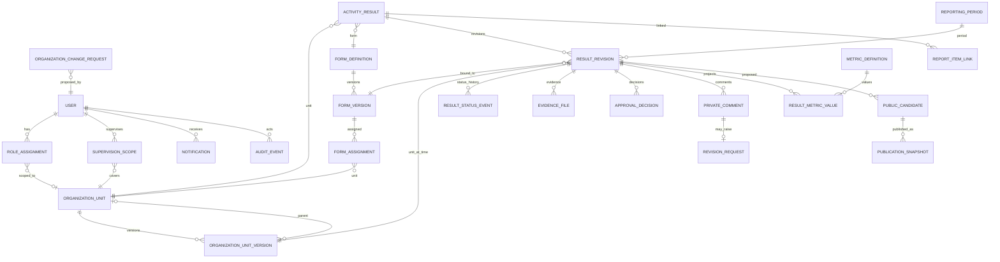

# ERD (dastlabki taklif)

> **Maqom: PROPOSED.** Jadval nomlari TT 4.10 ro'yxatiga asoslangan (Specified); ustunlar, aloqalar va cheklovlar — Proposed. Maydon darajasidagi M02/M04/M05 ma'lumotlari **ataylab kiritilmagan** (Unresolved).

## Asosiy jadvallar va cheklovlar (Proposed)
| Jadval | Muhim ustunlar / qoidalar |
|---|---|
| `OrganizationUnit` | `id` (doimiy). Tuzilma ma'lumotlari `…Version` da |
| `OrganizationUnitVersion` | `unit_id, name, type, parent_unit_id, valid_from, valid_to`; bir unit uchun muddatlar kesishmaydi (exclusion constraint) |
| `OrganizationChangeRequest` | `kind(create/rename/reparent/close), payload, status, proposed_by, approved_by, effective_from`. Tasdiqsiz kuchga kirmaydi |
| `User`, `RoleAssignment` | `user_id, role, unit_id?, valid_from, valid_to` (bir nechta rol, muddatli) |
| `SupervisionScope` | prorektor ↔ unit; administrator tayinlaydi |
| `FormDefinition` / `FormVersion` | `FormVersion`: `schema JSONB, status, version_no`; `published` bo'lgach UPDATE taqiqlanadi (trigger) |
| `FormAssignment` | `form_version_id, unit_id, valid_from, valid_to, evidence_required` |
| `ActivityResult` | `id, unit_id, form_id, created_by` (TT 4.10) |
| `ResultRevision` | `result_id, rev_no, form_version_id, payload JSONB, event_date, period_id, content_checksum, created_at, unit_version_id`; `UNIQUE(result_id, rev_no)`; kontent immutable |
| `ResultStatusEvent` | status o'tishlari (append-only): `revision_id, from, to, actor, at` |
| `EvidenceFile` | `storage_key, sha256, mime, size, scan_status, revision_id` |
| `ApprovalDecision` | `revision_id, approver_id, decision, note`; CHECK: `approver_id ≠ revision.created_by` (trigger) |
| `PrivateComment` | `author_id, recipient_user_id, revision_id, body`; javob jadvali **yo'q** (AC-06) |
| `RevisionRequest` | izohga bog'liq qayta ko'rish so'rovi |
| `ReportingPeriod`, `ReportItemLink` | davr; davriy hisobot → joriy natijaga havola (dedup) |
| `MetricDefinition` | `code, unit_of_measure, aggregation_rule` |
| `ResultMetricValue` | `revision_id, metric_id, value NULLABLE` (NULL ≠ 0) |
| `PublicCandidate`, `PublicationSnapshot` | snapshot: `version_no, numeric payload, published_by, published_at, status(active/rolled_back)`; matnli maydon yo'q |
| `Notification` | `user_id, kind, channel(in_app/email), delivery_status, retry_count`; email'da maxfiy matn yo'q |
| `AuditEvent` | append-only; maxfiy matn yo'q |

## Yaxlitlik mexanizmlari (Proposed)
1. `ResultRevision`, `ResultStatusEvent`, `AuditEvent`, `PublishedFormVersion`: `BEFORE UPDATE/DELETE` trigger'lari xato qaytaradi; ilova DB roli uchun `REVOKE UPDATE, DELETE`.
2. `content_checksum` (SHA-256) saqlashda hisoblanadi, o'qishda tekshirish imkoniyati.
3. PUBLIC o'qish roli faqat `PublicationSnapshot*` jadvallariga SELECT oladi.

## Unresolved
Metrika kataloglari, M02/M04/M05 maydonlari, dedup identifikatori formulasi, retention muddatlari, xodim/talaba identifikatorlari saqlanadimi (shaxsiy ma'lumot siyosati).
