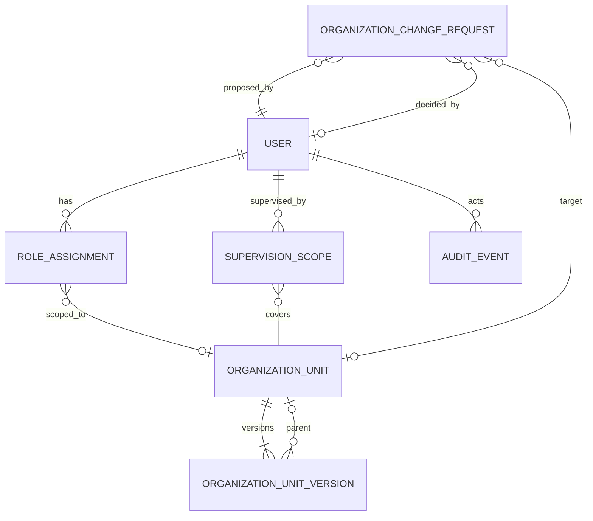

# Phase 2 rejasi — Identity + M01 (ERD va ruxsat matritsasi)

> **Maqom:** P2-1…P2-8 qarorlari egasi tomonidan **tasdiqlangan (2026-11-21)**; reja qolgani PROPOSED. Milestone 2.1 va 2.2 implementatsiya qilingan va dev bazaga qo'llangan (2.2: tashkiliy tuzilma tarixi; scope'li o'qish rollar bilan to'liq 2.3 da sinaladi). Manba: TT v4.0 (loyiha, imzosiz), `erd.md`, `permission-matrix.md`.
> Phase 2 doirasi: autentifikatsiya/sessiya, foydalanuvchilar, muddatli rollar, tashkiliy tuzilma tarixi, tuzilma o'zgarishi taklifi/tasdig'i, backend ruxsat tekshiruvi, audit skeleti.
> **Doiradan tashqari:** formalar, natijalar, dalil fayllari, izohlar, analitika, nashr, bildirishnomalar (Phase 3–5).
> Barcha ma'lumot **sintetik**. Haqiqiy tuzilma/shaxslar (B1–B4) OPEN.

## 1. Phase 2 ERD (faqat shu faza jadvallari)

| Jadval | Ustunlar | Cheklovlar / izoh |
|---|---|---|
| `User` (custom `AUTH_USER_MODEL`) | `id, email (login), full_name, is_active, password, last_login, created_at` | `email` UNIQUE (case-insensitive). O'z-o'zini ro'yxatdan o'tkazish yo'q. `is_staff/is_superuser` ishlatilmaydi (Django admin yoqilmaydi) |
| `OrganizationUnit` | `id, code (immutable, UNIQUE), created_at` | Faqat doimiy identifikator. Nom/tur/ota — versiyada |
| `OrganizationUnitVersion` | `unit_id, name, type, parent_unit_id?, valid_from, valid_to?, change_request_id?` | `EXCLUDE USING gist (unit_id WITH =, daterange(valid_from, valid_to) WITH &&)` — bir unit uchun muddatlar kesishmaydi; ota o'zi bo'lolmaydi, sikl yo'q (servis + DB tekshiruv); `type` ∈ {faculty, department, office, center} (**nomlar Proposed**) |
| `RoleAssignment` | `user_id, role, unit_id?, valid_from, valid_to?, assigned_by` | `role` — kodda aniqlangan enum (TT 4.2 rollari + `org_structure_approver`); CHECK `valid_to > valid_from`; unit talab qilinadigan rollar uchun CHECK |
| `SupervisionScope` | `user_id (vice-rector), unit_id, valid_from, valid_to?, assigned_by` | Prorektor faqat administrator biriktirgan unitlarni ko'radi |
| `OrganizationChangeRequest` | `kind (create/rename/reparent/close), target_unit_id?, payload JSON, status (proposed/approved/rejected/withdrawn), proposed_by, decided_by?, decided_at?, effective_from, decision_note` | CHECK: `decided_by ≠ proposed_by`; `effective_from` majburiy; tasdiqlangach versiya qatori yoziladi |
| `AuditEvent` | `id, at, actor_id?, action, object_type, object_id, request_id, ip, outcome` | Append-only (trigger). Parol, token, maxfiy matn **yozilmaydi** |

**Muhim dizayn qarorlari**
- **Tarix o'zgarmas:** tuzilma o'zgarishi yangi `…Version` qatori + oldingisining `valid_to` yopilishi. O'tgan natijalar o'z davridagi versiyaga bog'lanadi (Phase 3 `unit_version_id`).
- **Scheduler kerak emas:** `effective_from` kelajakda bo'lgan versiya sanasi kelganda o'zi kuchga kiradi (barcha so'rovlar "as-of sana" bo'yicha). Celery/cron Phase 2 da kiritilmaydi.
- **Daraxt so'rovi:** "dekan — o'z fakulteti va barcha ostidagi kafedralar" rekursiv CTE (as-of sana). Closure jadvali faqat o'lchangan ish unumdorligi muammosi bo'lsa.
- **Rollar vaqtida:** har so'rovda `valid_from <= now < valid_to` tekshiriladi; kesh yo'q (so'rov doirasidan tashqari).

## 2. Ruxsat matritsasi (Phase 2 amallari)

Belgilar: ✔ ruxsat · ○ faqat scope ichida · ✖ taqiqlangan. Scope tashqarisidagi obyekt → **404**; scope ichida lekin amal taqiqlangan → **403**.

| Amal | Tex. admin | Rektor | Prorektor | Dekan | Mudir/rahbar | Org-tasdiqlovchi | Tasdiqlovchi/Publisher | Anonim |
|---|---|---|---|---|---|---|---|---|
| Login / logout / `me` | ✔ | ✔ | ✔ | ✔ | ✔ | ✔ | ✔ | login faqat |
| Foydalanuvchi yaratish/faolsizlantirish | ✔ | ✖ | ✖ | ✖ | ✖ | ✖ | ✖ | ✖ |
| Rol/scope tayinlash | ✔ (o'ziga ✖ — Proposed) | ✖ | ✖ | ✖ | ✖ | ✖ | ✖ | ✖ |
| Unit daraxtini o'qish | ✔ barchasi | ✔ barchasi | ○ scope | ○ o'z fakulteti + ostidagilar | ○ o'z unit | ✔ barchasi | ○ biriktirilgan (Proposed) | ✖ |
| Unit tarixini o'qish | ✔ | ✔ | ○ | ○ | ○ | ✔ | ✖ | ✖ |
| Tuzilma o'zgarishini taklif qilish | ✔ | ✖ | ✖ | ✖ | ✖ | ✖ | ✖ | ✖ |
| Taklifni tasdiqlash/rad etish | ✖ | ✖ | ✖ | ✖ | ✖ | ✔ (o'zinikini emas) | ✖ | ✖ |
| Taklifni ko'rish | ✔ | ✔ | ✖ | ✖ | ✖ | ✔ | ✖ | ✖ |
| Audit hodisalarini o'qish | ✔ (maxfiy kontentsiz) | ? | ✖ | ✖ | ✖ | ✖ | ✖ | ✖ |

`?` — **Unresolved** (rektor audit jurnalini ko'radimi).
"Org-tasdiqlovchi" — sintetik rol; haqiqiy shaxs/lavozim **B2 (OPEN)**. Tex. admin o'zi taklif qilganini tasdiqlamaydi (CHECK + servis).

**Ruxsat tekshiruvi arxitekturasi (Proposed):** yagona `policy` moduli: `can(user, action, obj=None, at=now)` va `scope_queryset(user, qs)`. View/serializer ichida tarqoq `if role ==` yo'q. Har view ruxsat sinfini aniq e'lon qiladi (default — deny, allaqachon o'rnatilgan).

## 3. Majburiy negative testlar (Phase 2 darvozasi)
1. Boshqa fakultet dekani unit tarixi/tafsilotini ola olmaydi (404).
2. Muddati o'tgan (`valid_to`) / hali boshlanmagan rol ishlamaydi.
3. Tex. admin o'z taklifini tasdiqlay olmaydi (servis + DB CHECK).
4. Tex. admin o'ziga rektor roli tayinlay olmaydi.
5. Prorektor scope'dan tashqari unitni ko'rmaydi (list, detail, qidiruv).
6. Faolsizlantirilgan foydalanuvchi mavjud sessiya bilan ham kira olmaydi.
7. Anonim har qanday himoyalangan endpointda 401/403.
8. `OrganizationUnitVersion` muddatlari kesishmaydi (DB darajasida, to'g'ridan-to'g'ri INSERT ham).
9. `AuditEvent` ga UPDATE/DELETE (API va DB) rad etiladi.
10. Bir vaqtda ikkita tasdiq/rad so'rovi (concurrency): faqat biri muvaffaqiyatli.
11. CSRF'siz POST rad etiladi; login brute-force throttle.
12. Xato javoblari va loglarda parol/token/sessiya yo'q.

## 4. Auth/sessiya (Proposed; ADR-005 Approved asosida)
Django session (DB-backed), `HttpOnly`, `Secure` (staging/prod), `SameSite=Lax`, CSRF majburiy. Parol: Django validatorlari, minimal uzunlik **12 (Proposed)**. Login throttle: **5/daqiqa** IP+hisob bo'yicha (**Proposed, G6 OPEN**). Sessiya: **30 daqiqa bo'sh turish / 12 soat mutlaq (Proposed, OPEN)**. MFA — Phase 2 oxirida qayta ko'riladi.

## 5. Milestone'lar (har biri alohida tasdiq; migratsiya = alohida ruxsat)
| # | Mazmun | Tekshiruv |
|---|---|---|
| 2.1 | Custom `User`, login/logout/me, CSRF, throttle, `AuditEvent` skeleti, `policy` moduli bo'sh qobiq. **Migratsiya #1** | Auth testlari, #6–7, #11–12 |
| 2.2 | `OrganizationUnit/Version` + exclusion constraint, sintetik seed, scope'li o'qish API | #1, #5, #8 |
| 2.3 | `RoleAssignment`, `SupervisionScope`, admin API, policy to'liq | #2, #4, #5, #6 |
| 2.4 | `OrganizationChangeRequest` + tasdiq + `effective_from` | #3, #10 |
| 2.5 | To'liq izolyatsiya/concurrency to'plami, `AuditEvent` immutability, Phase 2 hisoboti | #9 va barchasi |
Frontend login sahifasi 2.1 dan keyin alohida kichik milestone (hozircha backend birinchi).

## 6. Qarorlar (P2-1…P2-8: Approved 2026-11-21)
| ID | Qaror | Tavsiya |
|---|---|---|
| P2-1 | Login identifikatori: email | email (UNIQUE, case-insensitive) |
| P2-2 | **Ikki DB roli:** `owner` (migratsiya) va `app` (runtime, faqat DML, `AuditEvent`/`ResultRevision` da UPDATE/DELETE yo'q). Hozirgi `qardu` roli — egasi, shuning uchun `REVOKE` uni cheklamaydi | Ha; `dev-db-setup.ps1` kengaytiriladi. Trigger'lar zaxira himoya sifatida qoladi |
| P2-3 | Unit daraxtini o'qish ko'lami (jadvaldagi "○") | Scope + ota zanjiri (breadcrumb) |
| P2-4 | `btree_gist` kengaytmasi (exclusion constraint uchun) | PostgreSQL'da `trusted`, baza egasi yarata oladi; migratsiya ichida |
| P2-5 | Parol/throttle/sessiya qiymatlari (G6) | §4 dagi qiymatlar |
| P2-6 | Tex. admin o'ziga rol tayinlay olmaydi | Ha |
| P2-7 | Audit o'qish huquqi (rektor?) | Hal qiling yoki Unresolved qoldiring |
| P2-8 | `org_structure_approver` sintetik rol; haqiqiy shaxs keyinroq (B2) | Ha |

## 7. Xavflar
- Custom `User` modeli **birinchi migratsiyadan oldin** tanlanishi shart; keyin almashtirish og'ir. Shuning uchun P2-1 oldindan hal qilinadi.
- Unit tuzilmasi haqiqiy reyestrdan farq qilishi mumkin: modeldagi `type` ro'yxati va daraxt chuqurligi B1 javobigacha o'zgarishi mumkin (migratsiya orqali).
- Rol nomlari (TT 4.2) haqiqiy lavozimlar bilan mos kelmasligi mumkin (B3/B4).
